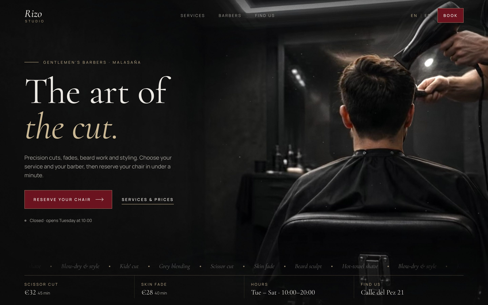
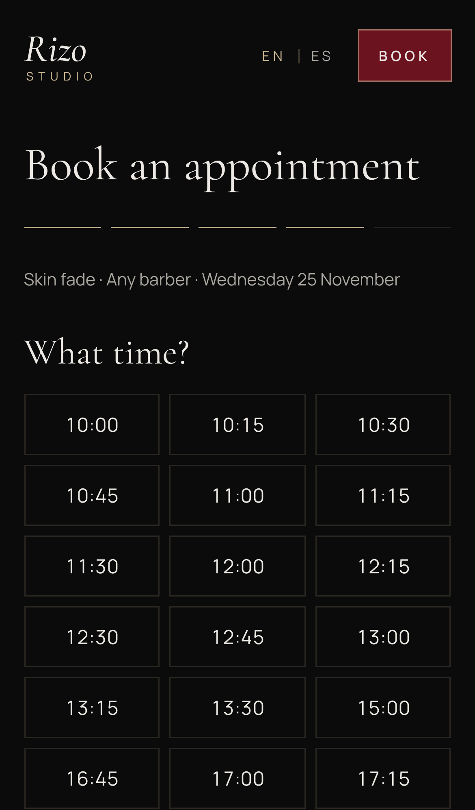
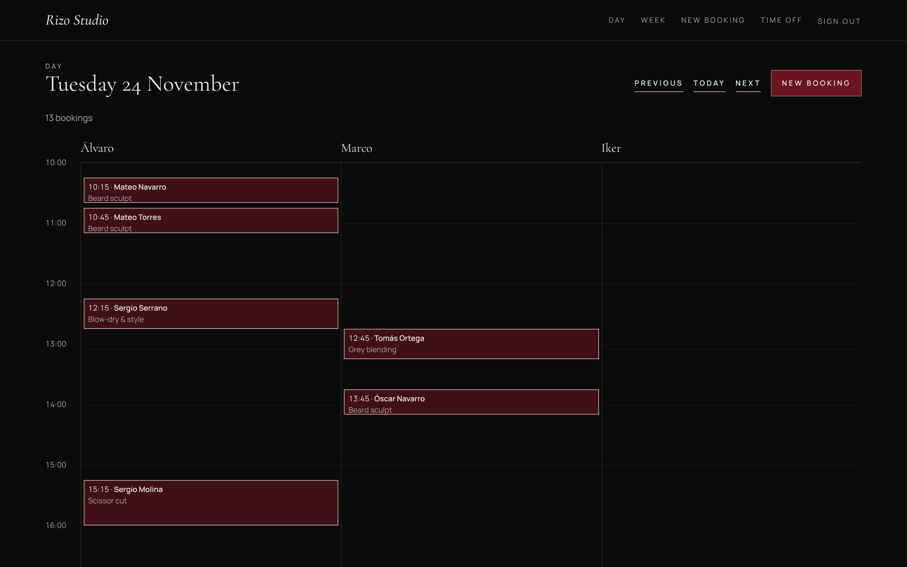

# Salon Booking

Online booking for barbershops and hair salons: an animated 3D homepage, a one-minute booking flow on the phone, private links to manage or cancel, and a dashboard for the salon. One deployment = one salon; everything salon-specific lives in a single file, `salon.config.ts`.

The demo salon is **Rizo Studio**, a fictional gentlemen's barbershop in Malasaña, Madrid.

**Live demo:** _coming soon_ · Admin demo login is shown on `/admin/login` when the demo runs.



| Phone homepage (ES) | Booking on the phone | Salon dashboard |
| --- | --- | --- |
|  |  |  |

## Features

- **Animated 3D homepage.** A real video of a barber at work, played through WebGL with a depth map so the camera drifts in 3D and follows the pointer. Light bloom, dust, film grain, headline reveal, scrolling services, magnetic buttons. Falls back to the still photo without WebGL or with reduced motion.
- **Booking in under a minute.** Service → barber (or "any barber") → day → time → details. Free times are computed from opening hours, each barber's hours and days off, service length plus clean-up buffer, existing bookings, time off, minimum notice and the booking window, in the salon's time zone (DST included).
- **No double bookings, ever.** PostgreSQL enforces it with an exclusion constraint, so two people pressing "Confirm" at the same instant cannot both get the slot. The loser sees the next free times.
- **Private manage link** to view, cancel (until 2 hours before) or add the appointment to a calendar (`.ics`). No customer accounts.
- **Confirmation emails** in English or Spanish through Resend (printed to the log when no key is set).
- **Salon dashboard:** day and week views per barber, phone and walk-in bookings, move, cancel, no-show, time off (refused when bookings are in the way, with the list), delete a customer's data.
- **Find us** with an embedded Google Map, "Get directions", hours and phone.
- **English and Spanish**, configurable per salon. GDPR defaults: consent checkbox, privacy page generated from the config, automatic anonymisation after 24 months.
- **Demo mode:** realistic data, reset every hour, demo login on the login page, no emails sent.
- **Abuse protection:** rate limits on booking and login, invisible honeypot field.

## Tech stack

Next.js (App Router) · TypeScript · Tailwind CSS · PostgreSQL (Neon) with Drizzle ORM · PGlite for local development and tests · zod · WebGL · Resend · Vitest · Playwright · GitHub Actions

## Run it locally

```bash
npm install
cp .env.example .env.local   # then fill ADMIN_EMAIL, ADMIN_PASSWORD_HASH, SESSION_SECRET
npm run dev                   # http://localhost:3000
```

No database to install: without `DATABASE_URL` the app uses an embedded PostgreSQL (PGlite) stored in `.data/`.
Create the admin password hash with `node scripts/hash-password.mjs "your password"`.
Set `DEMO_MODE=true` to load demo data and show the demo login.

## Customise for a new salon

1. Edit **`salon.config.ts`**: name, legal name, address, phone, email, map coordinates and Google Maps link, opening hours, services (names in each language, duration, price, buffer), barbers (services, hours, days off), languages, colours and fonts, booking rules.
2. Replace the files in **`public/hero/`**: `hero.webp` (16:9 photo), `depth.webp` (its depth map, white = near) and optionally `hero.mp4` / `hero.webm`. Without a video, set `hero.video` to `null`: the photo still moves in 3D.
3. `npm test` and `npm run e2e` (the end-to-end tests read names from the config).

Nothing else needs to change. Services, prices, team and weekly hours are edited in the config by the developer (part of the monthly support); one-off closures are added by the salon in the dashboard under **Time off**.

## Deploy (one client = their own accounts)

Vercel's free Hobby plan is for non-commercial use, so paying clients get their own Vercel and Neon accounts.

1. **Database:** create a Neon project (EU region) and copy its connection string.
2. **Vercel:** import the GitHub repository, then set the environment variables from `.env.example`: `DATABASE_URL`, `ADMIN_EMAIL`, `ADMIN_PASSWORD_HASH`, `SESSION_SECRET`, `CRON_SECRET`, `APP_URL`, and later `RESEND_API_KEY` / `EMAIL_FROM`. Migrations run automatically during the build when `DATABASE_URL` is set.
3. **Daily job:** `vercel.json` schedules `/api/cron/maintenance` (anonymisation and demo reset). Vercel sends `CRON_SECRET` automatically.
4. **Emails:** verify the salon's domain in Resend, then set `RESEND_API_KEY` and `EMAIL_FROM`. Until then, the confirmation page always shows the manage link.
5. **Google Business Profile:** point the salon's "Website" and "Book" links to the deployed site.

## Tests

```bash
npm test          # unit and database tests (availability, DST, double booking, emails, auth…)
npm run e2e       # Playwright: booking flow, two visitors racing for one slot, manage page, admin
npm run lint && npm run typecheck && npm run build
```

## Privacy text

The privacy page is a template generated from the config. It is not legal advice; each salon is responsible for its final wording.

## Licence

MIT © Ziad El Alami
